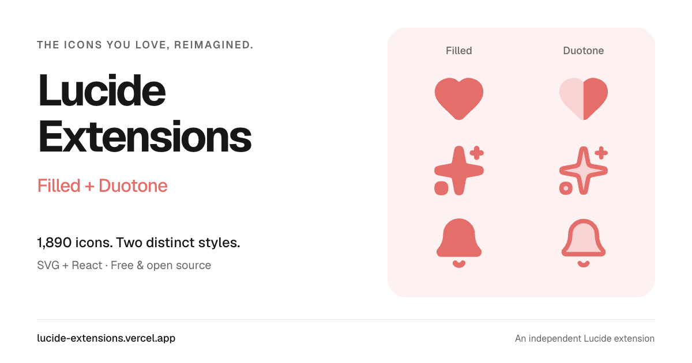

# Lucide Extensions



**1,890 icons. Filled and duotone. One consistent library.**

An independent extension of [Lucide](https://lucide.dev), with 3,780 SVG assets, 42 categories, and tree-shakable React components. Designed on a 24 × 24 grid with `currentColor` and transparent cutouts. Duotone defaults to 22% secondary opacity.

[Browse icons](https://lucide-extensions.vercel.app/) · [Download v0.1.0](https://github.com/yzi-yzi/lucide-extensions/releases/tag/v0.1.0) · [Paper design](https://app.paper.design/file/01M4X7ABDPS9FKKG3FTC271A46) · [Architecture decision](docs/architecture.md)

## Install

Install the built package from GitHub Releases (no npm registry publication is required):

```sh
npm install https://github.com/yzi-yzi/lucide-extensions/releases/download/v0.1.0/yzi-yzi-lucide-extensions-0.1.0.tgz
```

React is an optional peer dependency. React 18+ is required only when using the React entry points.

## React

```jsx
import { Heart } from '@yzi-yzi/lucide-extensions/react/filled';
import { Sparkles } from '@yzi-yzi/lucide-extensions/react/duotone';

<Heart size={24} color="#e76e6e" aria-label="Favorite" />
<Sparkles size={24} secondaryOpacity={0.22} />
```

Both styles export the same PascalCase names. Individual imports are also available:

```jsx
import Heart from '@yzi-yzi/lucide-extensions/react/duotone/heart';
```

Components forward refs, accept standard SVG props, support ESM and CommonJS, and include TypeScript declarations. Size defaults to 24 and color to `currentColor`. Decorative icons have `aria-hidden="true"`; supply `title`, `aria-label`, or `aria-labelledby` when the icon conveys meaning. Label icon-only buttons on the button itself.

## SVG and plain JavaScript

```js
// SVG string: suitable for trusted inline rendering or custom framework adapters.
import heartSvg from '@yzi-yzi/lucide-extensions/core/duotone/heart';

// File asset: behavior depends on your bundler's SVG loader.
import heartUrl from '@yzi-yzi/lucide-extensions/filled/heart.svg';
```

Raw files live in `icons/filled` and `icons/duotone`. The release also contains a ZIP with all SVGs and license notices. The gallery supports name/tag/alias search, category browsing, color and size controls, secondary opacity, SVG copying/downloads, and React snippets.

## Repository structure

```text
icons/{filled,duotone}/   Approved SVG source of truth
metadata/                Names, tags, aliases, categories, source checksums
packages/react/          Shared React component factory and types
packages/core/           Framework-neutral package documentation
scripts/                 Deterministic builds and catalog/package tests
apps/web/                React + shadcn/ui + Tailwind CSS gallery
docs/                    Architecture and release process
dist/                    Generated ESM, CommonJS, and declarations (not tracked)
```

## Develop

Node 22.12+ (Node 24 recommended).

```sh
npm ci
npm run check   # Build library, verify catalog/components/tree shaking, build site
npm run dev     # http://127.0.0.1:4173
npm pack       # Build an installable package
```

The website uses React, TypeScript, Tailwind CSS v4, and the shadcn/ui New York components. See [the web UI guide](apps/web/README.md) for component conventions and theming.

A GitHub Actions template is included at `docs/ci-workflow.yml`. Move it to `.github/workflows/ci.yml` using a GitHub connection with workflow permission to enable CI. The current release was validated locally.

The live gallery is hosted on [Vercel](https://lucide-extensions.vercel.app/). The connected GitHub repository automatically deploys changes to `main`. A [GitHub Pages mirror](https://yzi-yzi.github.io/lucide-extensions/) is served from the `gh-pages` branch; run `npm run build:pages` to generate its assets.

For Vercel, use the repository root, `npm run build:web`, and output `apps/web/dist`. The gallery is static and needs no database or environment secrets.

## Contribute

See [CONTRIBUTING.md](CONTRIBUTING.md). Keep both styles, metadata, tests, and the website synchronized in one change. Generated components and website assets must not be edited directly.

## License and attribution

Independent project; not affiliated with or endorsed by Lucide Icons. Based on Lucide snapshot `d672fc43dbf60962d9d829e35bc3b3e5ed89a178`. Includes the complete 1,890-icon snapshot, including three upstream-deprecated entries.

[ISC license and original Feather MIT notices](LICENSE) · [Provenance and adaptation notice](NOTICE.md)
